# Mapa Mental y Visión General: Estación J6 (Smart Hub)

La aplicación **EstacionJ6** es un sistema domótico centralizado tipo pantalla inteligente (*Smart Display / Kiosk*) desarrollado en **Kotlin** y **Jetpack Compose**. Su finalidad es convertir un dispositivo Android (específicamente optimizado para terminales de características fijas como un Samsung Galaxy J6) en una consola doméstica de control 24/7 interactiva.

---

## 1. Mapa Mental del Sistema

```mermaid
flowchart TD
    Root["Smart Hub J6 (EstacionJ6)"]

    %% RAMA 1: SISTEMA & KIOSK
    Root --> Kiosk["1. Sistema & Modo Kiosk"]
    Kiosk --> K1["Pantalla Completa Inmersiva (HideSystemUI)"]
    Kiosk --> K2["Keep Screen On & Auto-Unlock"]
    Kiosk --> K3["Bloqueo Navegación (Back & Home Trap)"]
    Kiosk --> K4["Orientación Landscape Sensor"]
    Kiosk --> K5["Atenuación Automática por Ausencia"]

    %% RAMA 2: GESTIÓN DE ESTADO Y REACTIVIDAD
    Root --> StateNode["2. Estado & Lógica (MainViewModel)"]
    StateNode --> S1["HubUiState (StateFlow Único)"]
    StateNode --> S2["Loop de Reloj y Alarmas (1 seg)"]
    StateNode --> S3["Loop de Polling IoT & Clima (5 seg)"]
    StateNode --> S4["Gestión de Despertar Manual (30s timeout)"]
    StateNode --> S5["Ducking de Audio en escucha activa"]

    %% RAMA 3: HARDWARE IOT & BATERÍA
    Root --> IoT["3. IoT, Sensores & Batería"]
    IoT --> I1["ESP32 ESPHome (.13 /api/status)"]
    I1 --> I1A["AHT20/DHT: Temp & Humedad"]
    I1 --> I1B["BMP280: Presión Atmosférica"]
    I1 --> I1C["LD2410: Radar Presencia & Movimiento"]
    IoT --> I2["Control de Relé (/api/rele/{on|off})"]
    IoT --> I3["Gestor de Batería J6 (BatteryManagerHelper)"]
    I3 --> I3A["Histeresis Inteligente: Carga 20% a 80%"]

    %% RAMA 4: MULTIMEDIA & STREAMING
    Root --> Media["4. Multimedia & Streaming"]
    Media --> M1["ExoPlayer (Media3)"]
    Media --> M2["Navidrome (Subsonic API)"]
    M2 --> M2A["Autenticación MD5 + Salt"]
    M2 --> M2B["Búsqueda Jerárquica: Canción / Artista / Álbum"]
    Media --> M3["Radio Online (Radio-Browser API)"]
    Media --> M4["Plex Media Server (Direct Play / Series & Movies)"]
    Media --> M5["YouTube Embed (Preparado)"]

    %% RAMA 5: INTELIGENCIA ARTIFICIAL & VOZ
    Root --> Voice["5. Asistente de Voz & IA"]
    Voice --> V1["Reconocimiento de Voz (SpeechRecognizer es-ES)"]
    Voice --> V2["Síntesis de Voz (TextToSpeech)"]
    Voice --> V3["Gemini 1.5 Flash (GenerativeModel)"]
    V3 --> V3A["Inferencia JSON con Intent Parsing"]
    Voice --> V4["Cerebro de Emergencia (Regex + NLP Léxico Offline)"]

    %% RAMA 6: CLIMA EXTERIOR & LOCALIZACIÓN
    Root --> Weather["6. Clima & Ubicación"]
    Weather --> W1["LocationManager (GPS / Network)"]
    Weather --> W2["Reverse Geocoding (Geocoder Ciudad)"]
    Weather --> W3["Open-Meteo REST API"]
    W3 --> W3A["Variables: Temp, Hum, Presión, Viento, Precipitación, UV"]
    W3 --> W3B["Mapeo Códigos WMO con Emojis"]

    %% RAMA 7: INTERFAZ DE USUARIO (COMPOSE)
    Root --> UI["7. Interfaz Gráfica (Compose)"]
    UI --> U1["SmartHubDashboard (Horizontal Scroll)"]
    U1 --> U1A["Card Reloj & Fecha Dinámica"]
    U1 --> U1B["Card Comparativa Clima (IN vs OUT)"]
    U1 --> U1C["Card Gestión Alarmas & Recordatorios"]
    U1 --> U1D["Card Reproductor & Carátulas (Coil)"]
    UI --> U2["Overlays Interactivos"]
    U2 --> U2A["Atenuación Progresiva (dimAlpha)"]
    U2 --> U2B["Alarma Activada (Alerta visual pulsante)"]
    U2 --> U2C["Transcripción de Voz Flotante"]
```

---

## 2. Mapa de Nodos y Estructura de Documentación

A continuación se detalla el desglose por nodos para su análisis en profundidad, con acceso directo a cada documento especializado:

| Nodo | Título del Módulo | Archivo de Documentación | Componentes Clave Involucrados |
| :--- | :--- | :--- | :--- |
| **01** | **Arquitectura & Modo Kiosk** | [`01_ARQUITECTURA_Y_KIOSK.md`](./01_ARQUITECTURA_Y_KIOSK.md) | `MainActivity.kt`, `AndroidManifest.xml` |
| **02** | **Gestión de Estado & ViewModel** | [`02_GESTION_ESTADO_Y_VIEWMODEL.md`](./02_GESTION_ESTADO_Y_VIEWMODEL.md) | `MainViewModel.kt`, `HubUiState` |
| **03** | **Domótica IoT, Sensores & Batería** | [`03_DOMOTICA_IOT_Y_BATERIA.md`](./03_DOMOTICA_IOT_Y_BATERIA.md) | `EspHomeApi.kt`, `HubRepositoryImpl.kt`, `BatteryManagerHelper.kt` |
| **04** | **Multimedia, Audio & Streaming** | [`04_MULTIMEDIA_STREAMING.md`](./04_MULTIMEDIA_STREAMING.md) | `MusicRepository.kt`, `PlexRepository.kt`, `RadioRepository.kt`, `ExoPlayer` |
| **05** | **Asistente de Voz & Cerebro IA** | [`05_ASISTENTE_VOZ_E_IA.md`](./05_ASISTENTE_VOZ_E_IA.md) | `VoiceAssistantManager.kt`, Gemini 1.5 Flash SDK |
| **06** | **Meteorología & Geolocalización** | [`06_METEOROLOGIA_Y_GEOLOCALIZACION.md`](./06_METEOROLOGIA_Y_GEOLOCALIZACION.md) | `WeatherRepository.kt`, `WeatherApi.kt`, Open-Meteo |
| **07** | **Interfaz UI Jetpack Compose** | [`07_INTERFAZ_UI_JETPACK_COMPOSE.md`](./07_INTERFAZ_UI_JETPACK_COMPOSE.md) | `SmartHubDashboard.kt`, `DashboardScreen.kt` |
| **08** | **Evaluación Crítica & Plan de Mejoras** | [`08_EVALUACION_CRITICA_Y_MEJORAS.md`](./08_EVALUACION_CRITICA_Y_MEJORAS.md) | Seguridad, Arquitectura, Rendimiento AMOLED |

---

## 3. Resumen Ejecutivo de la Solución

- **Objetivo**: Estación fija de control del hogar colocada en pared o soporte de mesa.
- **Microcontrolador Asociado**: ESP32 ejecutando ESPHome en la red local (`192.168.1.13`), equipado con radar mmWave LD2410 (detección de presencia humana micrométrica), sensor ambiental AHT20/BMP280 y relé conmutador del cargador.
- **Inteligencia**: Asistente con control multimodal de voz; utiliza Gemini 1.5 Flash para extraer intenciones domóticas y multimedia, y dispone de un fallback algorítmico sin conexión a internet.
- **Servidores Locales**: Navidrome para música personal y Plex Media Server para vídeo y series.
