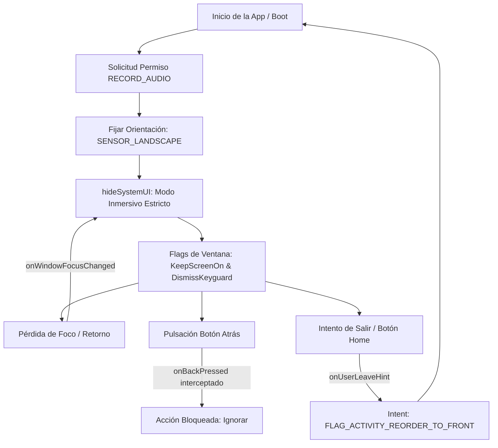
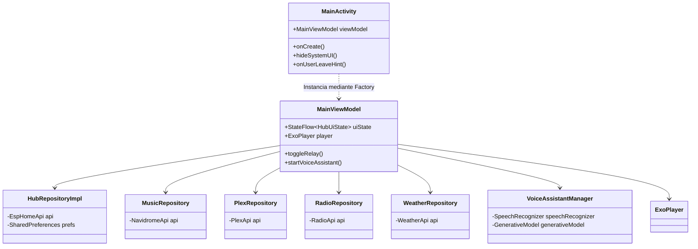

# Nodo 1: Arquitectura Base y Modo Kiosk

Este documento analiza en profundidad el ciclo de vida, la configuración a nivel de sistema operativo y los mecanismos implementados en la clase [`MainActivity.kt`](file:///home/jcramossa/AndroidStudioProjects/EstacionJ6/app/src/main/java/com/example/estacionj6/MainActivity.kt) y el manifiesto [`AndroidManifest.xml`](file:///home/jcramossa/AndroidStudioProjects/EstacionJ6/app/src/main/AndroidManifest.xml) para convertir un teléfono Android en un terminal Kiosk permanente.

---

## 1. Patrón Kiosk y Modo Always-On

Para que el dispositivo funcione de manera ininterrumpida como consola centralizada, el sistema aplica las siguientes técnicas:



### 1.1. Inmersión de Pantalla (`hideSystemUI`)
La aplicación oculta completamente las barras de navegación y de estado del sistema:
- **En Android 11+ (API 30+)**: Usa `WindowInsetsController` con comportamiento `BEHAVIOR_SHOW_TRANSIENT_BARS_BY_SWIPE`, permitiendo interactuar con bordes sin que la interfaz del sistema desplace los elementos Compose.
- **En versiones anteriores (API < 30, como el Samsung J6 con Android 8/9/10)**: Aplica los flags clásicos:
  ```kotlin
  View.SYSTEM_UI_FLAG_IMMERSIVE_STICKY
  or View.SYSTEM_UI_FLAG_LAYOUT_STABLE
  or View.SYSTEM_UI_FLAG_LAYOUT_HIDE_NAVIGATION
  or View.SYSTEM_UI_FLAG_LAYOUT_FULLSCREEN
  or View.SYSTEM_UI_FLAG_HIDE_NAVIGATION
  or View.SYSTEM_UI_FLAG_FULLSCREEN
  ```
- **Reactivación**: Se engancha a `onWindowFocusChanged(hasFocus: Boolean)` para volver a invocar `hideSystemUI()` si un diálogo o notificación temporal desplegó la barra.

### 1.2. Mantenimiento de Pantalla y Desbloqueo (`Window Flags`)
En `onCreate`, se configuran directivas a la ventana de la ventana:
- `FLAG_KEEP_SCREEN_ON`: Impide que el temporizador de inactividad de Android suspenda el hardware o apague el panel.
- `FLAG_DISMISS_KEYGUARD`: Salta el bloqueo de pantalla si el dispositivo se reinicia.
- `FLAG_SHOW_WHEN_LOCKED`: Asegura que la aplicación se dibuje por encima de cualquier pantalla de bloqueo.
- `FLAG_TURN_SCREEN_ON`: Enciende la pantalla si estaba suspendida al arrancar.

### 1.3. Mecanismos Anti-Escape (Kiosk Lock)
1. **Bloqueo de botón Atrás (`onBackPressed`)**:
   Sobrescrito intencionadamente sin invocar `super.onBackPressed()`. El usuario no puede retroceder ni cerrar la Activity con el botón físico o virtual de atrás.
2. **Trampa de Botón Inicio / Minimización (`onUserLeaveHint`)**:
   Cuando el usuario presiona el botón Home o intenta cambiar de tarea, el callback `onUserLeaveHint()` dispara de inmediato un Intent explícito con las banderas `FLAG_ACTIVITY_NEW_TASK` y `FLAG_ACTIVITY_REORDER_TO_FRONT`, devolviendo a la app al primer plano sin latencia perceptible.

---

## 2. Configuración del Manifiesto (`AndroidManifest.xml`)

### 2.1. Permisos Declarados
| Permiso | Propósito en la App |
| :--- | :--- |
| `android.permission.INTERNET` | Comunicación HTTP con el ESP32 local, Navidrome, Plex, Radio-Browser, Open-Meteo y la API de Gemini. |
| `android.permission.ACCESS_NETWORK_STATE` | Verificación de conectividad activa. |
| `android.permission.ACCESS_WIFI_STATE` | Detección de conectividad Wi-Fi local para los servicios domóticos. |
| `android.permission.ACCESS_FINE_LOCATION` | Obtención de coordenadas GPS precisas para el cálculo de previsión meteorológica local. |
| `android.permission.ACCESS_COARSE_LOCATION` | Obtención de coordenadas por antenas/red en interiores donde no hay cobertura GPS. |
| `android.permission.RECORD_AUDIO` | Acceso al micrófono para el reconocimiento de voz del asistente inteligente. |

### 2.2. Políticas de Red y Tráfico HTTP Claro
- `android:usesCleartextTraffic="true"` y `android:networkSecurityConfig="@xml/network_security_config"`:
  Indispensable dado que los microcontroladores locales (ESP32 con ESPHome en `http://192.168.1.13`) y servidores internos (`http://192.168.1.30:4533` y `http://192.168.1.30:32400`) operan sobre HTTP plano sin certificado SSL.

### 2.3. Modo de Lanzamiento
- `launchMode="singleInstance"`: Asegura que no se puedan apilar múltiples instancias de `MainActivity` en la pila de tareas, garantizando que el ciclo Kiosk se mantenga sobre una única instancia activa.

---

## 3. Inyección de Dependencias Manual en `MainActivity`

La aplicación utiliza actualmente el patrón **ViewModelProvider.Factory** personalizado en `MainActivity` para instanciar el [`MainViewModel`](file:///home/jcramossa/AndroidStudioProjects/EstacionJ6/app/src/main/java/com/example/estacionj6/ui/main/MainViewModel.kt) con sus repositorios y servicios asociados:



### Parámetros cableados en el Factory:
- **ESP32**: Conexión a través del singleton [`NetworkClient.api`](file:///home/jcramossa/AndroidStudioProjects/EstacionJ6/app/src/main/java/com/example/estacionj6/data/remote/NetworkClient.kt) (`http://192.168.1.13/`).
- **Navidrome**: Credenciales fijas (`admin` / `admin`) y URL base local `http://192.168.1.30:4533/`.
- **Plex**: Token fijo de usuario (`Sz1L76j34TQPsX5CV7Tw`) y URL `http://192.168.1.30:32400`.
- **ExoPlayer**: Instanciado a nivel de contexto de aplicación y compartido entre el ViewModel y la vista de Compose.
