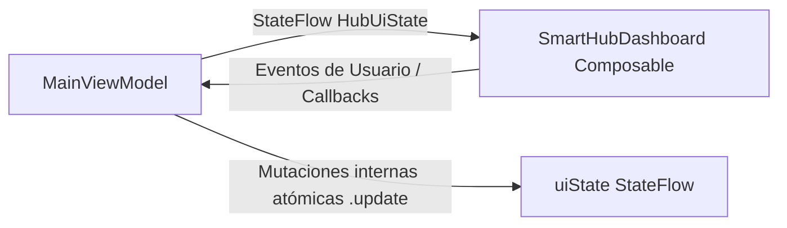
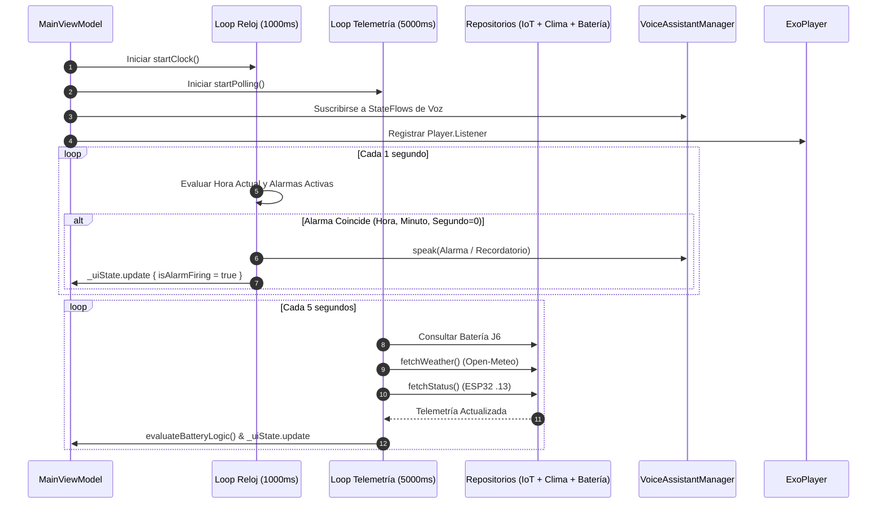

# Nodo 2: Gestión de Estado y Lógica de Negocio (MainViewModel)

Este documento detalla el cerebro reactivo de la aplicación: [`MainViewModel.kt`](file:///home/jcramossa/AndroidStudioProjects/EstacionJ6/app/src/main/java/com/example/estacionj6/ui/main/MainViewModel.kt) y su modelo de estado inmutable [`HubUiState`](file:///home/jcramossa/AndroidStudioProjects/EstacionJ6/app/src/main/java/com/example/estacionj6/data/model/EspHomeModels.kt#L41).

---

## 1. El Estado Unificado (`HubUiState`)

La aplicación sigue el patrón **UDF (Unidirectional Data Flow)** de Jetpack Compose, concentrando toda la información en un único `data class` inmutable expuesto a través de `StateFlow<HubUiState>`:



### Atributos Clave del Estado:
- **Temporales**: `currentTime` ("HH:mm"), `currentDate` ("EEEE, d 'de' MMMM").
- **Sensores Locales (IN)**: `temperature`, `humidity`, `pressure` (AHT20/BMP280 en ESP32).
- **Radar de Presencia (LD2410)**: `isPresenceDetected`, `isMovingPresence`, `isStaticPresence`.
- **Clima Exterior (OUT)**: `extTemperature`, `extHumidity`, `extPressure`, `windSpeed`, `windDirection`, `precipitation`, `cloudCover`, `weatherDescription`, `uvIndex`, `weatherLocationName`.
- **Hardware Dispositivo (J6)**: `phoneBatteryLevel`, `isPhoneCharging`, `isRelayOn`, `isDimmed`, `isLoading`, `error`.
- **Multimedia**: `musicTitle`, `musicArtist`, `musicCoverUrl`, `isPlaying`, `isMusicLoading`, `isRadioActive`, `radioName`, `plexTitle`, `isPlexActive`, `plexMediaUrl`, `youtubeVideoId`.
- **Asistente de Voz**: `isListening`, `isThinking`, `voiceTranscript`.
- **Alarmas y Recordatorios**: `alarms` (lista), `isAlarmFiring`, `firingAlarmLabel`.

---

## 2. Corrutinas y Bucles Concurrentes

Al inicializarse el `MainViewModel` en su bloque `init`, se arrancan los siguientes procesos en segundo plano usando `viewModelScope`:



### 2.1. Loop de Reloj y Disparo de Alarmas (`startClock()`)
- Ejecutado cada 1000 ms.
- Reconstruye los textos formateados de fecha y hora en español.
- Comprueba si el segundo exacto es `0` y si la hora y minuto coinciden con alguna alarma habilitada (`isEnabled == true`):
  - **Alarmas con fecha específica**: `specificDate == todayStr` ("yyyy-MM-dd").
  - **Alarmas repetitivas**: `repeatDays.contains(currentDayOfWeek)`.
  - **Diferenciación Alarma vs Recordatorio**:
    - Si `isReminder == true`: el asistente de voz lee el mensaje mediante TTS (`"Atención, recordatorio: $msg"`), sin activar la sirena en pantalla completa.
    - Si es alarma estándar: se dispara el overlay de alarma a pantalla completa (`isAlarmFiring = true`) y se anuncia vocalmente.

### 2.2. Loop de Polling de Sensores y Clima (`startPolling()`)
- Ejecutado cada 5000 ms. Invoca a `refreshData()`:
  1. **Lectura de Batería Local**: Lee el estado directo del sistema operativo vía `BatteryManagerHelper`.
  2. **Consulta Meteorológica Externa**: Invoca `weatherRepository.fetchWeather()` en `Dispatchers.IO` para no bloquear el hilo principal.
  3. **Consulta de Sensores ESP32**: Solicita `repository.fetchStatus()`.
  4. **Cálculo de Atenuación de Pantalla (Smart Dimming)**:
     ```kotlin
     isDimmed = !status.presence && !_manualWakeActive.value && !currentState.isAlarmFiring
     ```
     Si el radar LD2410 no detecta ninguna presencia humana en la habitación, ni la alarma está sonando, ni hay un despertar manual activo, la pantalla se atenúa automáticamente para ahorrar energía y evitar desgaste del panel AMOLED.

---

## 3. Despertar Manual de Pantalla (`manualWake()`)

Para permitir al usuario consultar la pantalla cuando el sensor de presencia aún no lo ha detectado o la habitación está a oscuras, se implementa `manualWake()`:
- Al recibir un doble toque en la pantalla (`detectTapGestures(onDoubleTap = { ... })`):
  1. Se establece `_manualWakeActive.value = true`.
  2. Se cancela la atenuación (`isDimmed = false`).
  3. Se inicia un temporizador de 30 segundos (`delay(30_000)`).
  4. Tras los 30 segundos, el flag se desactiva y el estado vuelve a depender exclusivamente del radar de presencia física.

---

## 4. Control de Ducking de Audio y Escucha Activa

El `MainViewModel` coordina la interacción entre el reproductor multimedia y el reconocimiento por voz:
- Cuando `voiceManager.isListening` emite `true` (el usuario está hablando):
  ```kotlin
  player.volume = 0.2f // Atenuación al 20%
  ```
- Cuando la escucha finaliza (`isListening = false`):
  ```kotlin
  player.volume = 1.0f // Restablecimiento al 100%
  ```
- Además, la transcripción de voz (`voiceTranscript`) se mantiene en pantalla durante 5 segundos mediante una corrutina temporal antes de ocultarse automáticamente.

---

## 5. Limpieza de Recursos (`onCleared`)

Dado que tanto `ExoPlayer` como los motores de reconocimiento y síntesis de voz mantienen servicios de sistema y códecs de bajo nivel:
```kotlin
override fun onCleared() {
    super.onCleared()
    player.release()
    voiceManager.release()
}
```
Esto previene fugas de memoria (*memory leaks*) en AudioTrack, AudioRecord y TextToSpeech.
