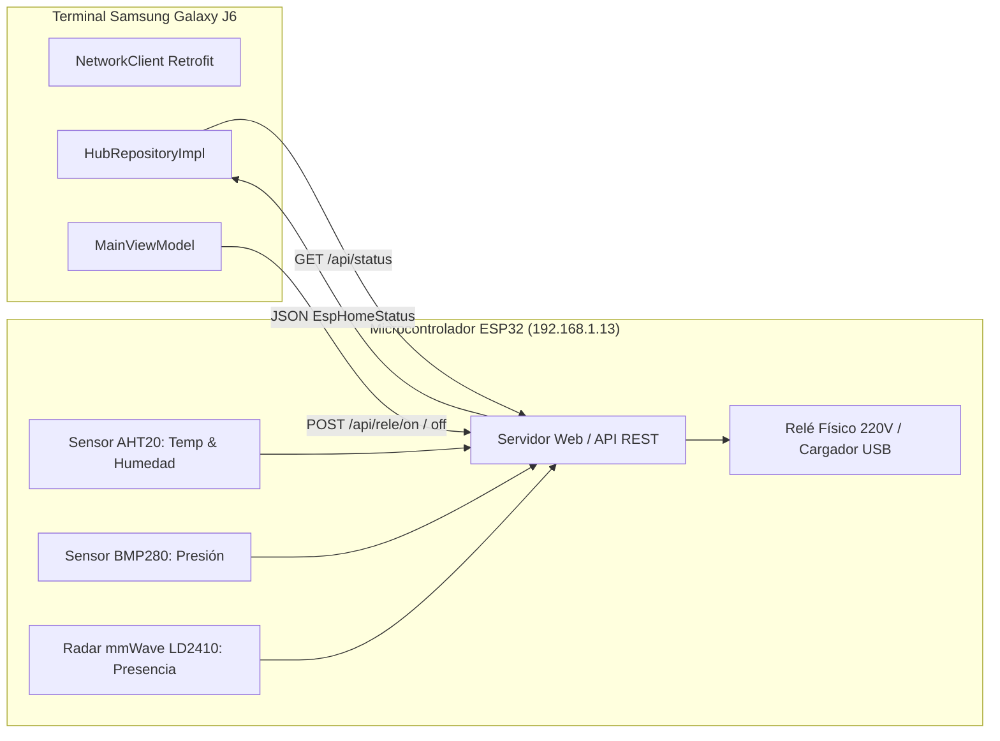
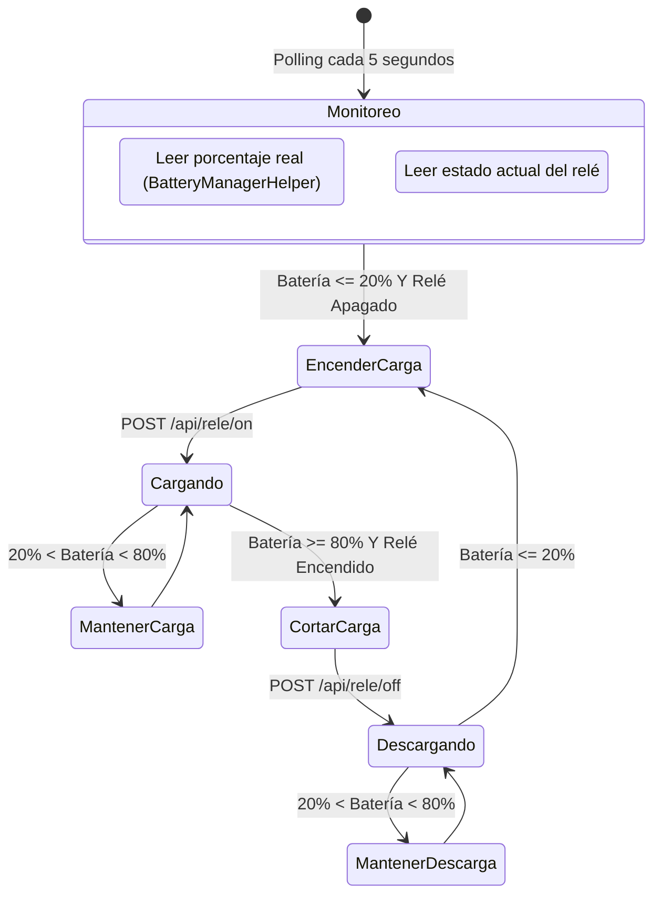

# Nodo 3: Domótica IoT, Sensores y Protección de Batería

Este documento analiza la comunicación con el microcontrolador local (ESP32 con firmware ESPHome), la adquisición de telemetría de sensores ambientales y radar de presencia, y el algoritmo automatizado de protección de batería del dispositivo móvil.

---

## 1. Conexión con el ESP32 (Microcontrolador Local)

El sistema se integra con un dispositivo ESP32 ubicado en la IP fija local `http://192.168.1.13/` mediante la interfaz Retrofit [`EspHomeApi.kt`](file:///home/jcramossa/AndroidStudioProjects/EstacionJ6/app/src/main/java/com/example/estacionj6/data/remote/EspHomeApi.kt).



### 1.1. Endpoints REST
1. **Consulta de Estado Unificado**: `GET http://192.168.1.13/api/status`
   Devuelve el payload JSON mapeado por la clase [`EspHomeStatus`](file:///home/jcramossa/AndroidStudioProjects/EstacionJ6/app/src/main/java/com/example/estacionj6/data/model/EspHomeModels.kt#L7):
   ```json
   {
     "rele": true,
     "presencia": true,
     "movimiento": true,
     "persona_estatica": false,
     "dht_temperatura": 21.5,
     "dht_humedad": 45.2,
     "aht_temperatura": 21.8,
     "aht_humedad": 44.9,
     "bmp_temperatura": 21.7,
     "bmp_presion": 1018.4
   }
   ```
2. **Conmutación del Relé**: `POST http://192.168.1.13/api/rele/{action}`
   Donde `{action}` toma el valor `"on"` o `"off"`.

---

## 2. Sensores Integrados y Propósito

| Sensor | Magnitud Medida | Variable en App | Rol en la Interfaz |
| :--- | :--- | :--- | :--- |
| **AHT20** | Temperatura y Humedad relativa interior | `ahtTemp`, `ahtHum` | Se muestra en la tarjeta ambiental interior ("IN (Sensor)"). Alta precisión y estabilidad frente al antiguo DHT. |
| **BMP280** | Presión barométrica interior | `bmpPressure` | Presión atmosférica en hPa para calibración local y predicción de cambios de tiempo. |
| **LD2410 (mmWave)** | Presencia global, movimiento y presencia estática | `presence`, `movement`, `staticPresence` | Radar de microondas de 24 GHz capaz de detectar la respiración humana (presencia estática). Controla la atenuación de pantalla (*Smart Dimming*). |
| **Relé 5V/220V** | Conexión eléctrica del cargador del J6 | `relay` | Encendido/apagado físico del adaptador de corriente del smartphone. |

---

## 3. Algoritmo Inteligente de Gestión de Batería

Uno de los mayores riesgos al reutilizar un smartphone antiguo como pantalla de pared 24/7 es la **degradación acelerada y el hinchamiento de la batería de litio (*battery swelling*)** si permanece conectada continuamente al 100% de carga.

Para solucionar esto, el `MainViewModel` implementa un algoritmo de carga con histéresis mediante la función `evaluateBatteryLogic()`:



### Reglas del Algoritmo:
1. **Regla de Carga Mínima**: Si el nivel de batería del Samsung J6 cae al **20% o menos** y el relé está apagado, se envía la orden de **encender el relé** (`toggleRelay(true)`).
2. **Regla de Corte Máximo**: Cuando la batería alcanza el **80% o más** y el cargador está activo, se envía la orden de **apagar el relé** (`toggleRelay(false)`).
3. **Zona de Histéresis Segura (21% - 79%)**: No se realiza ninguna acción de conmutación. Esto previene ciclos de conmutación continuos en el relé mecánico y prolonga la vida química de la celda de ion-litio por años.

---

## 4. Helper de Diagnóstico de Batería (`BatteryManagerHelper`)

En [`BatteryManagerHelper.kt`](file:///home/jcramossa/AndroidStudioProjects/EstacionJ6/app/src/main/java/com/example/estacionj6/util/BatteryManagerHelper.kt), se utiliza el receptor sticky del sistema Android para obtener lecturas inmediatas sin esperas:

```kotlin
val intentFilter = IntentFilter(Intent.ACTION_BATTERY_CHANGED)
val batteryStatus: Intent? = context.registerReceiver(null, intentFilter)
```

- Extrae el nivel actual (`EXTRA_LEVEL`) y la escala (`EXTRA_SCALE`) para calcular el porcentaje real normalizado `(level / scale) * 100`.
- Comprueba si el dispositivo está recibiendo corriente a través del flag `EXTRA_STATUS` verificando `BATTERY_STATUS_CHARGING` o `BATTERY_STATUS_FULL`.

---

## 5. Persistencia de Alarmas en `HubRepositoryImpl`

El repositorio [`HubRepositoryImpl.kt`](file:///home/jcramossa/AndroidStudioProjects/EstacionJ6/app/src/main/java/com/example/estacionj6/data/repository/HubRepositoryImpl.kt) administra el almacenamiento local de las alarmas y recordatorios:
- Utiliza `SharedPreferences` con el nombre de fichero `"smart_hub_prefs"`.
- Los objetos [`Alarm`](file:///home/jcramossa/AndroidStudioProjects/EstacionJ6/app/src/main/java/com/example/estacionj6/data/model/EspHomeModels.kt#L22) se serializan y deserializan en formato JSON utilizando `Gson` y `TypeToken<List<Alarm>>()`.
- Proporciona operaciones atómicas para consultar (`getAlarms`), guardar o actualizar (`saveAlarm`), eliminar (`deleteAlarm`) y conmutar el interruptor (`toggleAlarm`).
