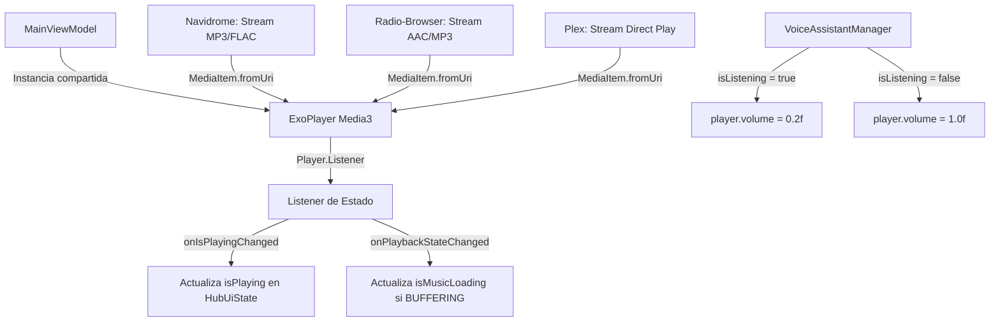
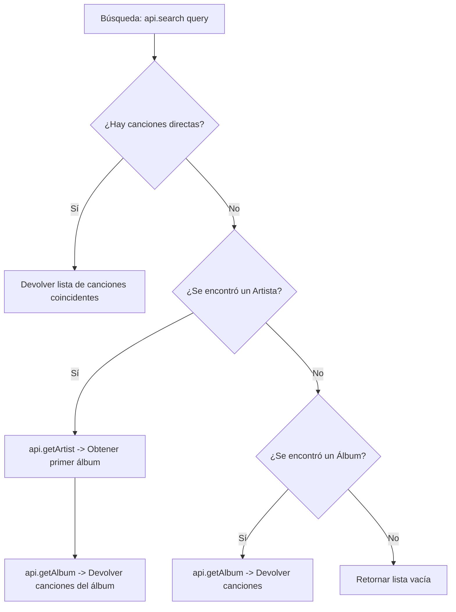
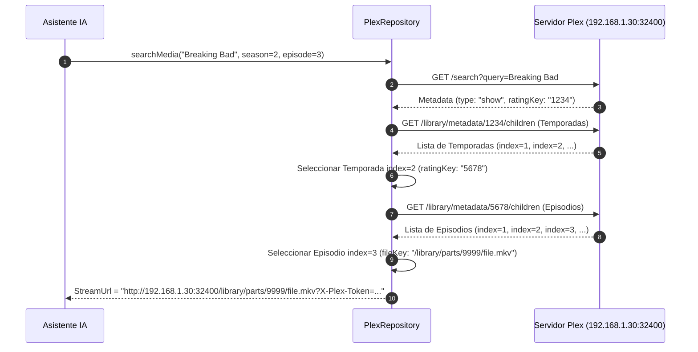

# Nodo 4: Multimedia, Audio y Streaming

Este documento profundiza en la arquitectura multimedia de **EstacionJ6**, que combina reproducción de audio local y en red con **Jetpack Media3 (ExoPlayer)**, streaming de música privada con **Navidrome (API Subsonic)**, sintonización de emisoras con **Radio-Browser**, streaming de vídeo doméstico con **Plex Media Server** y soporte para **YouTube**.

---

## 1. Motor de Reproducción de Audio: Jetpack Media3 (ExoPlayer)

La aplicación utiliza la biblioteca estándar de Android para reproducción audiovisual (`androidx.media3:media3-exoplayer:1.2.1`):



### Características implementadas:
- **Streaming directo por URL**: Se carga mediante `player.setMediaItem(MediaItem.fromUri(streamUrl))`, seguido de `player.prepare()` y `player.play()`.
- **Ducking de Audio**: Al activarse el asistente de voz, el volumen del reproductor se reduce automáticamente a `0.2f` (20%) para permitir que el micrófono capture la voz del usuario sin eco ni interferencias de la música.
- **Liberación de Recursos**: En `MainViewModel.onCleared()`, se ejecuta `player.release()`, liberando códecs de hardware, buffers de audio y servicios del sistema.

---

## 2. Servidor de Música Personal: Navidrome (API Subsonic)

El repositorio [`MusicRepository.kt`](file:///home/jcramossa/AndroidStudioProjects/EstacionJ6/app/src/main/java/com/example/estacionj6/data/repository/MusicRepository.kt) implementa el protocolo de autenticación y consulta compatible con Subsonic API (v1.16.1) conectando con el servidor Navidrome en `http://192.168.1.30:4533/`.

### 2.1. Protocolo de Autenticación Subsonic (Token + Salt MD5)
Para no enviar la contraseña en texto plano en cada petición GET:
```kotlin
val salt = UUID.randomUUID().toString().substring(0, 8)
val token = md5(pass + salt)
```
Donde `md5` realiza el digest criptográfico de la contraseña concatenada con el valor aleatorio (*salt*).

### 2.2. Algoritmo de Búsqueda en Cascada (Cascading Search)
Cuando el usuario solicita reproducir algo (por ejemplo: *"Pon Queen"* o *"Pon Bohemian Rhapsody"*), `searchSongs(query)` resuelve el contenido de forma inteligente en 3 niveles:



1. **Nivel 1 (Canción directa)**: Si la API devuelve canciones en `searchResult.songs`, toma la primera coincidencia.
2. **Nivel 2 (Artista)**: Si el término coincide con un artista (ej. *"AC/DC"*), consulta sus álbumes con `getArtist()` y extrae las canciones del primer álbum disponible.
3. **Nivel 3 (Álbum)**: Si el término coincide con un título de disco, consulta el álbum con `getAlbum()` y reproduce sus canciones.

---

## 3. Emisoras de Radio en Directo: Radio-Browser API

La aplicación se integra con la API comunitaria internacional [Radio-Browser](https://www.radio-browser.info/) mediante [`RadioApi.kt`](file:///home/jcramossa/AndroidStudioProjects/EstacionJ6/app/src/main/java/com/example/estacionj6/data/remote/RadioApi.kt) y [`RadioRepository.kt`](file:///home/jcramossa/AndroidStudioProjects/EstacionJ6/app/src/main/java/com/example/estacionj6/data/repository/RadioRepository.kt).

- **Servidor Base**: `https://de1.api.radio-browser.info/`
- **Endpoint**: `GET json/stations/byname/{name}?limit=5&order=votes&reverse=true`
- **Lógica**: Ordena las emisoras por votos comunitarios de forma descendente y selecciona la estación más popular y estable.
- **Metadatos y Carátula**: Extrae el nombre oficial de la emisora (`station.name`), la URL directa del stream de audio (`station.url`) y el favicon/logotipo de la emisora (`station.favicon`).

---

## 4. Servidor Multimedia de Vídeo y Series: Plex Media Server

[`PlexRepository.kt`](file:///home/jcramossa/AndroidStudioProjects/EstacionJ6/app/src/main/java/com/example/estacionj6/data/repository/PlexRepository.kt) implementa la navegación por el catálogo de medios de un servidor Plex en `http://192.168.1.30:32400/`.

### 4.1. Resolución de Series, Temporadas y Episodios
Cuando el usuario solicita reproducir una serie por voz (por ejemplo: *"Pon Breaking Bad temporada 2 capítulo 3"*):



### 4.2. Direct Play
- La URL de streaming obtenida (`$baseUrl$fileKey?X-Plex-Token=$token`) apunta directamente a la parte física del archivo multimedia en Plex, permitiendo al reproductor realizar **Direct Play** sin transcodificación en el servidor cuando el códec es compatible.

---

## 5. Visualización en Tarjeta Musical (`MusicCard`)

En [`SmartHubDashboard.kt`](file:///home/jcramossa/AndroidStudioProjects/EstacionJ6/app/src/main/java/com/example/estacionj6/ui/components/SmartHubDashboard.kt#L368), la UI presenta un componente unificado para cualquier fuente sonora:
- **Carátulas con Coil**: Usa `AsyncImage` para descargar y cachear dinámicamente las carátulas tanto de Navidrome como los logotipos de emisoras de radio.
- **Estados Dinámicos**:
  - Si el reproductor está cargando (`isLoading == true`), muestra un `CircularProgressIndicator` en el botón central.
  - Alterna entre los iconos `PlayArrow` y `Pause`.
  - Diferencia visualmente con iconos temáticos entre reproducción de música local (`MusicNote`) y radio en directo (`Radio`).
