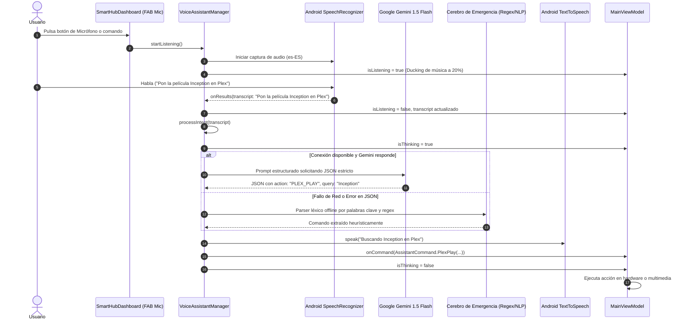

# Nodo 5: Asistente de Voz y Procesamiento de Lenguaje Natural (IA)

Este documento detalla la arquitectura de control por voz del Smart Hub implementada en [`VoiceAssistantManager.kt`](file:///home/jcramossa/AndroidStudioProjects/EstacionJ6/app/src/main/java/com/example/estacionj6/util/VoiceAssistantManager.kt). El sistema cuenta con una arquitectura de doble motor: inferencia neuronal en la nube con **Gemini 1.5 Flash** y un **cerebro de emergencia offline** basado en heurística y expresiones regulares.

---

## 1. Flujo de Trabajo Multimodal de Voz



---

## 2. Reconocimiento y Síntesis de Voz Nativas

### 2.1. Speech-to-Text (STT)
- Utiliza la clase nativa `android.speech.SpeechRecognizer`.
- Configurado con `RecognizerIntent.LANGUAGE_MODEL_FREE_FORM` y localización `es-ES`.
- Implementa `RecognitionListener`:
  - `onReadyForSpeech`: Notifica inicio de captura (`_isListening = true`).
  - `onPartialResults`: Proporciona transcripción en tiempo real mientras el usuario continúa hablando.
  - `onResults`: Extrae la cadena de texto más probable y la entrega a la cadena de procesamiento.

### 2.2. Text-to-Speech (TTS)
- Implementa `TextToSpeech.OnInitListener` fijando el idioma a `Locale("es", "ES")`.
- Responde por voz al usuario con confirmaciones auditivas amigables (`speak(text)` con `TextToSpeech.QUEUE_FLUSH`).

---

## 3. Inferencia Semántica con Gemini 1.5 Flash

Para interpretar órdenes complejas en lenguaje natural sin requerir comandos rígidos, la aplicación utiliza el SDK oficial de Google AI:
- **Modelo**: `gemini-1.5-flash-latest` (optimizado para baja latencia).
- **Prompting de Salida Estructurada**: Se fuerza al modelo a responder exclusivamente un objeto JSON parseable:

```text
Responde SOLO un JSON: {
  "response": "..",
  "action": "ALARM_SET" | "MUSIC_PLAY" | "MUSIC_STOP" | "RELAY_ON" | "RELAY_OFF" | "RADIO_PLAY" | "YOUTUBE_PLAY" | "PLEX_PLAY",
  "hour": 8,
  "minute": 30,
  "label": "..",
  "isReminder": false,
  "query": "búsqueda",
  "season": 1,
  "episode": 5
}
```

### 3.1. Extracción de Parámetros
- **Acciones Domóticas**: `RELAY_ON`, `RELAY_OFF`.
- **Acciones de Alarma/Recordatorio**: Extrae horas, minutos, etiquetas de texto y clasifica si se trata de un recordatorio puntual (`isReminder = true`) o una alarma despertador.
- **Acciones Multimedia**: Extrae términos de búsqueda y separa temporada (`season`) y episodio (`episode`) si se solicita una serie para Plex.

---

## 4. El Cerebro de Emergencia (Motor Offline)

Si la conexión a Internet falla, la cuota de la API de Gemini se agota o la respuesta de la IA no contiene un JSON válido, el bloque `catch` activa un **motor heurístico de emergencia**:

### 4.1. Diccionario de Números en Texto a Enteros
Mapea palabras comunes en español a sus valores numéricos:
```kotlin
val wordMap = mapOf(
    "CERO" to 0, "UNA" to 1, "UNO" to 1, "DOS" to 2, "TRES" to 3, 
    "CUATRO" to 4, "CINCO" to 5, "DIEZ" to 10, "QUINCE" to 15,
    "VEINTE" to 20, "TREINTA" to 30, "CUARENTA" to 40, "CINCUENTA" to 50
    // ...
)
```
Si el usuario dice *"Alarma a las ocho y media"* o *"Recuérdame a las siete y quince"*, el algoritmo busca tanto dígitos numéricos (`\d+`) como palabras del diccionario para construir la hora y el minuto de forma autónoma.

### 4.2. Despacho Heurístico por Reglas
1. **Alarmas y Recordatorios**:
   Detecta `"ALARMA"` o `"RECUÉRDAME"`.
2. **Radio**:
   Detecta `"RADIO"` o `"EMISORA"`. Limpia conectores habituales (*"pon la radio"*, *"pon la emisora"*) y envía el nombre limpio a Radio-Browser.
3. **Detener Reproducción**:
   Detecta `"QUITAR"`, `"PARAR"`, `"DETENER"`, `"SILENCIO"` o `"PARA LA"`.
4. **Música, Plex y YouTube**:
   Detecta `"MÚSICA"` o `"PON"`. Aplica reglas de desambiguación:
   - Si incluye `"VIDEO"` o `"YOUTUBE"` $\rightarrow$ Comando YouTube.
   - Si incluye `"PLEX"`, `"PELÍCULA"` o `"SERIE"` $\rightarrow$ Extrae con expresiones regulares `temporada \d+` y `capítulo \d+`, despachando a Plex.
   - En cualquier otro caso $\rightarrow$ Despacha a Navidrome.
5. **Relé Domótico**:
   Detecta `"ENCIENDE"` $\rightarrow$ `RelayOn`; `"APAGA"` $\rightarrow$ `RelayOff`.

---

## 5. Jerarquía de Comandos (`AssistantCommand`)

Los comandos resultantes se encapsulan en una jerarquía tipada segura mediante una `sealed class`:

```kotlin
sealed class AssistantCommand {
    data class MusicPlay(val query: String) : AssistantCommand()
    data class RadioPlay(val query: String) : AssistantCommand()
    data class YouTubePlay(val query: String) : AssistantCommand()
    data class PlexPlay(val query: String, val season: Int? = null, val episode: Int? = null) : AssistantCommand()
    object MusicStop : AssistantCommand()
    object RelayOn : AssistantCommand()
    object RelayOff : AssistantCommand()
    data class AlarmSet(
        val hour: Int, val minute: Int, 
        val repeatDays: List<Int>? = null,
        val specificDate: String? = null,
        val label: String? = null,
        val isReminder: Boolean = false
    ) : AssistantCommand()
    object None : AssistantCommand()
}
```
Esto permite al `MainViewModel` consumir cada intención con un bloque `when` exhaustivo y sin riesgo de excepciones de tipo en tiempo de ejecución.
