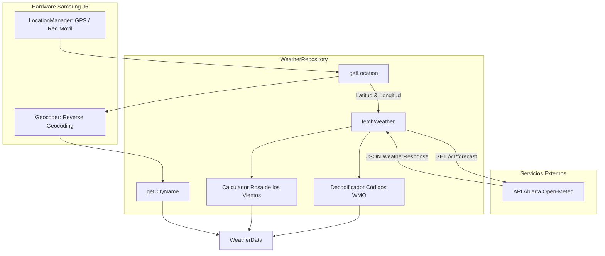

# Nodo 6: Meteorología y Geolocalización

Este documento profundiza en la adquisición de telemetría meteorológica externa, resolución de posición geográfica y geocodificación inversa implementada en [`WeatherRepository.kt`](file:///home/jcramossa/AndroidStudioProjects/EstacionJ6/app/src/main/java/com/example/estacionj6/data/repository/WeatherRepository.kt) y consumida mediante la API abierta **Open-Meteo**.

---

## 1. Arquitectura de Datos Meteorológicos

El Smart Hub combina dos fuentes de información climática complementarias:
1. **Mediciones Físicas Interiores (IN)**: Provenientes de los sensores de hardware conectados al microcontrolador ESP32 (AHT20 y BMP280).
2. **Previsión Atmosférica Exterior (OUT)**: Proveniente de los satélites y modelos de predicción de Open-Meteo, calculados en base a la ubicación real del dispositivo.



---

## 2. Resolución de Coordenadas y Geocodificación

### 2.1. Selección de Proveedor de Ubicación (`getLocation`)
Para operar de manera óptima tanto en exteriores como dentro de una vivienda donde la señal GPS puede ser débil o nula:
- Consulta tanto `LocationManager.GPS_PROVIDER` como `LocationManager.NETWORK_PROVIDER`.
- Si ambos proveedores entregan una lectura, compara las marcas de tiempo (`time`) y selecciona **la más reciente**.
- Si no hay señal disponible o los permisos no fueron otorgados, utiliza un *fallback* seguro fijado en las coordenadas de Madrid (`40.4168, -3.7038`).

### 2.2. Geocodificación Inversa (`getCityName`)
Convierte el par `(latitud, longitud)` en un nombre de población comprensible para el usuario:
- Utiliza la clase nativa `android.location.Geocoder(context, Locale.getDefault())`.
- Evalúa en cascada: `locality` (municipio) $\rightarrow$ `subAdminArea` (comarca/partido) $\rightarrow$ `adminArea` (provincia/comunidad).
- Si el servicio de geocodificación de Google Play Services falla, muestra directamente las coordenadas formateadas `"lat, lon"`.

---

## 3. Integración con la API de Open-Meteo

Se utiliza la interfaz Retrofit [`WeatherApi.kt`](file:///home/jcramossa/AndroidStudioProjects/EstacionJ6/app/src/main/java/com/example/estacionj6/data/remote/WeatherApi.kt):
- **Base URL**: `https://api.open-meteo.com/`
- **Endpoint**: `GET v1/forecast`
- **Parámetros consultados en tiempo real**:
  ```http
  ?latitude={lat}&longitude={lon}&current=temperature_2m,relative_humidity_2m,surface_pressure,apparent_temperature,wind_speed_10m,wind_direction_10m,weather_code,uv_index,precipitation,cloud_cover
  ```

### 3.1. Mapeo de Códigos Meteorológicos WMO (`getWeatherDescription`)
Los modelos meteorológicos numéricos devuelven los estados del cielo mediante el estándar de la Organización Meteorológica Mundial (WMO). El repositorio los transforma en descripciones visuales con emojis enriquecidos:

| Rango de Códigos WMO | Condición Meteorológica | Emoji Asociado |
| :--- | :--- | :--- |
| `0` | Cielo despejado | ☀️ |
| `1, 2, 3` | Parcialmente nublado / Intervalos nubosos | ⛅ |
| `45, 48` | Niebla y niebla con escarcha | 🌫️ |
| `51, 53, 55, 56, 57` | Llovizna y llovizna helada | 🌧️ |
| `61, 63, 65, 66, 67` | Lluvia moderada o fuerte | 🌧️ |
| `71, 73, 75, 77` | Nieve y granos de nieve | ❄️ |
| `80, 81, 82` | Chubascos de lluvia | 🌦️ |
| `95, 96, 99` | Tormenta eléctrica con o sin granizo | ⛈️ |
| *Cualquier otro* | Clima variable | 🌤️ |

### 3.2. Conversión de Ángulo de Viento a Puntos Cardinales
Transforma los grados sexagesimales de dirección de viento ($0^\circ - 360^\circ$) en la rosa de los vientos de 8 rumbos:
```kotlin
val directions = arrayOf("N", "NE", "E", "SE", "S", "SO", "O", "NO")
val index = (((degrees + 22.5f) % 360) / 45).toInt()
return "${directions[index]} (${degrees.toInt()}°)"
```
Permite presentar al usuario valores intuitivos como `"SO (225°)"` en lugar de un ángulo abstracto.

---

## 4. Estructura de Datos Unificada: `WeatherData`

El resultado final se empaqueta en el siguiente modelo de dominio:
```kotlin
data class WeatherData(
    val temperature: Float,
    val humidity: Float,
    val pressure: Float,
    val apparentTemperature: Float,
    val windSpeed: Float,
    val windDirection: String,
    val precipitation: Float,
    val cloudCover: Float,
    val weatherDescription: String,
    val uvIndex: Float,
    val locationName: String
)
```
Estos valores alimentan directamente las columnas visuales de la tarjeta [`ClimateAndStatusCard`](file:///home/jcramossa/AndroidStudioProjects/EstacionJ6/app/src/main/java/com/example/estacionj6/ui/components/SmartHubDashboard.kt#L236) en Compose.
