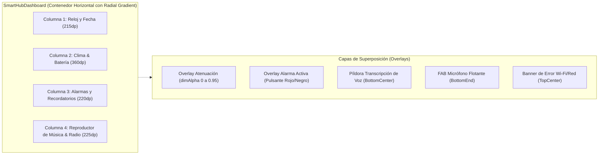

# Nodo 7: Interfaz Gráfica con Jetpack Compose

Este documento analiza la construcción de la interfaz visual en Jetpack Compose implementada principalmente en [`SmartHubDashboard.kt`](file:///home/jcramossa/AndroidStudioProjects/EstacionJ6/app/src/main/java/com/example/estacionj6/ui/components/SmartHubDashboard.kt) y la pantalla complementaria [`DashboardScreen.kt`](file:///home/jcramossa/AndroidStudioProjects/EstacionJ6/app/src/main/java/com/example/estacionj6/ui/components/DashboardScreen.kt).

---

## 1. Diseño Orientado a Pantalla Apaisada (*Landscape Panel*)

Dado que el dispositivo se monta horizontalmente en pared o mesita de noche, [`SmartHubDashboard`](file:///home/jcramossa/AndroidStudioProjects/EstacionJ6/app/src/main/java/com/example/estacionj6/ui/components/SmartHubDashboard.kt#L36) implementa una vista organizada en columnas modulares mediante `Row` con desplazamiento horizontal (`horizontalScroll`):



---

## 2. Desglose de Columnas y Componentes

### 2.1. Columna 1: Reloj Tipográfico de Alto Impacto
- Diseñado para lectura a gran distancia (desde la cama o el otro extremo de la habitación).
- **Hora**: Texto de `90.sp` con peso `FontWeight.ExtraBold` y espaciado negativo entre caracteres (`letterSpacing = (-4).sp`) para máxima compacidad.
- **Fecha**: Texto de `18.sp` en gris medio (`Color.Gray`) con el primer carácter en mayúscula.

### 2.2. Columna 2: Tarjeta de Clima Comparativo y Batería (`ClimateAndStatusCard`)
Diseñada con una superficie oscura de bordes redondeados (`Color(0xFF1E1E1E)`, `20.dp` de radio):
1. **Cabecera**: Localidad detectada por GPS/red con icono de marcador (`LocationOn`) y estado resumido del tiempo (`weatherDescription`).
2. **Comparativa IN vs OUT**:
   - **Columna IN (Sensor local ESP32)**: Temperatura, humedad y presión atmosférica barométrica directa de la habitación.
   - **Columna OUT (Servicio Web Open-Meteo)**: Temperatura exterior, humedad, presión, sensación térmica, velocidad y rumbo del viento, precipitación acumulada y cobertura de nubes.
3. **Control de Alimentación y Batería**:
   - Icono dinámico de batería (`BatteryChargingFull` vs `BatteryFull`) con color adaptativo (Rojo si $<20\%$, Verde en caso contrario).
   - Porcentaje numérico e indicador de estado del cargador (*"Cargador Activo"* vs *"Cargador Apagado"*).
   - Interruptor manual (`Switch`) para forzar la activación o corte del relé.

### 2.3. Columna 3: Gestión de Alarmas y Recordatorios
- Contenedor con scroll vertical propio (`verticalScroll`).
- Cada elemento (`AlarmItem`):
  - Muestra la hora formateada a dos dígitos (`%02d:%02d`) en tipografía destacada de `20.sp`.
  - Muestra la etiqueta descriptiva o motivo del recordatorio.
  - Botón de borrado rápido (`Delete`).
  - Interruptor (`Switch`) de activación/desactivación rápida.

### 2.4. Columna 4: Tarjeta Multimedia (`MusicCard`)
- **Carátula Asíncrona**: Integrada con la biblioteca `Coil` (`AsyncImage`) para portadas de canciones de Navidrome o favicons de emisoras de radio. Si no hay carátula, muestra un icono representativo (`Radio` o `MusicNote`).
- **Título y Artista**: Textos truncados a 1 línea con puntos suspensivos para evitar desbordamientos.
- **Control Unificado Play/Pause**: Botón de superficie blanca con contraste total que conmuta entre `PlayArrow` y `Pause`, o despliega un `CircularProgressIndicator` si la canción está en buffer (`isMusicLoading == true`).

---

## 3. Sistema de Overlays Interactivos y Animaciones

### 3.1. Atenuación Inteligente de Pantalla (`dimAlpha`)
Para alargar la vida útil del panel AMOLED del Samsung J6 y evitar que ilumine la estancia cuando no hay nadie presente:
```kotlin
val dimAlpha by animateFloatAsState(
    targetValue = if (state.isDimmed) 0.95f else 0f,
    animationSpec = tween(durationMillis = 800),
    label = "dimAlpha"
)
```
- Transición suave de 800 milisegundos mediante interpolador temporal (*tween*).
- El nivel de atenuación llega al **95% de opacidad negra**, manteniendo visible el contorno de los números sin emitir luz excesiva.
- **Despertar por Doble Toque**: Todo el fondo de la pantalla captura gestos táctiles mediante `pointerInput(Unit) { detectTapGestures(onDoubleTap = { onManualWake() }) }`.

### 3.2. Pantalla Completa de Alarma Disparada (`AlarmFiringOverlay`)
Cuando una alarma se activa (`isAlarmFiring == true`), se despliega una capa por encima de todo el contenido con animaciones infinitas para captar la atención inmediatamente:
- **Animación Cromática**: Alterna suavemente entre rojo semitransparente (`Color.Red.copy(alpha = 0.6f)`) y negro opaco cada 500 ms usando `rememberInfiniteTransition()`.
- **Efecto de Pulso/Escalado**: El icono de la campana de alarma escala cíclicamente entre `1.0x` y `1.1x` (`scale`).
- **Botón de Parada**: Un botón prominente de 200x80 dp con texto extra grande *"DETENER"* que invoca `onDismissAlarm()`.

### 3.3. Transcripción de Voz y Botón Flotante (FAB)
- **Cápsula Flotante de Transcripción**: Muestra el texto capturado por el micrófono en la parte inferior central (`Alignment.BottomCenter`) sobre una superficie oscura traslúcida.
- **FAB de Micrófono**: Ubicado en la esquina inferior derecha (`Alignment.BottomEnd`). Cambia dinámicamente su color a **Rojo** e icono a `MicOff` cuando el micrófono está grabando activamente, o a **Azul** con icono `Mic` en reposo.

---

## 4. Pantalla Alternativa Vertical (`DashboardScreen.kt`)

La base de código incluye también [`DashboardScreen.kt`](file:///home/jcramossa/AndroidStudioProjects/EstacionJ6/app/src/main/java/com/example/estacionj6/ui/components/DashboardScreen.kt), un diseño alternativo basado en `Scaffold` estándar de Material 3 con `TopAppBar`:
- Incluye el componente especializado [`PresenceCard`](file:///home/jcramossa/AndroidStudioProjects/EstacionJ6/app/src/main/java/com/example/estacionj6/ui/components/DashboardScreen.kt#L91), que muestra con código de color verde/gris si la habitación está ocupada (*"PRESENCIA DETECTADA"* vs *"HABITACIÓN VACÍA"*) y chips independientes para presencia de movimiento y presencia estática del sensor radar LD2410.
- Resulta ideal si en el futuro se desea utilizar el dispositivo en orientación vertical (*Portrait*).
